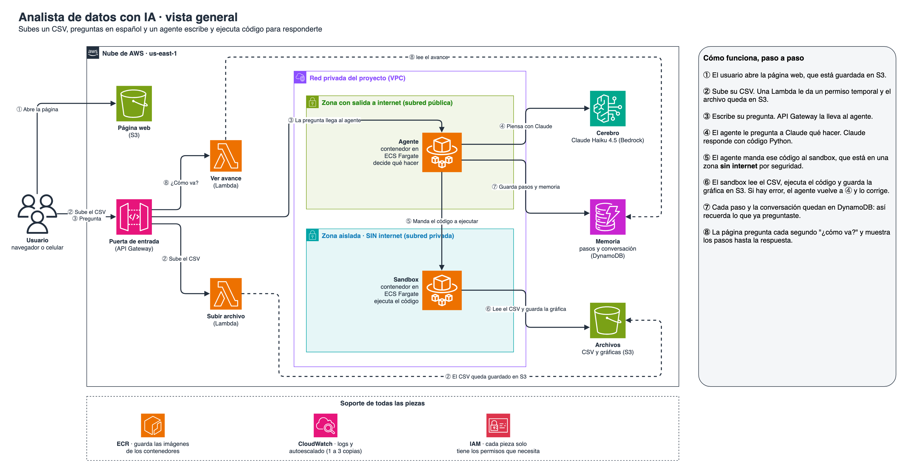

# Analista de datos con IA (Entrega final — Computación en la Nube)

Subes un CSV, preguntas en español ("¿qué mes vendió más?") y un **agente** con Claude Haiku 4.5 (Amazon Bedrock)
escribe código Python, lo ejecuta en un **sandbox aislado** sin internet, revisa el resultado y responde con texto y
gráficas. La página muestra cada paso en vivo: el código, los errores que el agente corrige y la respuesta final.
Recuerda la conversación (las preguntas siguientes pueden decir "ahora solo 2025").



| Documento | Qué contiene |
|---|---|
| [`arquitectura/arquitectura.drawio`](arquitectura/arquitectura.drawio) | Diagrama editable en draw.io (vista general y vista técnica) |
| [`arquitectura/arquitectura-tecnica.png`](arquitectura/arquitectura-tecnica.png) | Vista técnica: VPC, subredes, endpoints, seguridad |
| [`costos/estimacion.md`](costos/estimacion.md) | Costos verificados y las líneas para la AWS Pricing Calculator |
| [`docs/diseno-arquitectura.md`](docs/diseno-arquitectura.md) | Diseño: objetivos, decisiones y riesgos |
| [`docs/plan-implementacion.md`](docs/plan-implementacion.md) | Plan de implementación por tareas |

## Servicios de AWS

S3 (sitio web y datos), API Gateway (HTTP API), Lambda (subida y estado), ECS Fargate (agente y sandbox),
ECR (imágenes), Bedrock (Claude Haiku 4.5), DynamoDB (trabajos y memoria), VPC (subredes, endpoints, grupos de
seguridad), IAM (un rol por pieza, mínimo privilegio) y CloudWatch (solo logs).

## Estructura

```
app/agente/    ciclo agéntico (Claude + herramienta ejecutar_python), memoria y servidor HTTP
app/sandbox/   ejecuta el código de la IA: sin red, sin credenciales, 30 s, 768 MB, usuario sin privilegios
app/lambdas/   archivos.py (POST firmado a S3, máx. 10 MB) y trabajos.py (estado y gráficas)
app/dev/       api_falsa.py para probar la página sin AWS; generar_ventas.py
web/           la página (HTML, CSS y JS sin frameworks)
terraform/     toda la infraestructura (91 recursos en el plan)
datos-ejemplo/ ventas.csv: 200 ventas ficticias en 5 ciudades de Colombia
```

## Probar en tu computador (sin AWS, gratis)

```bash
cd EntregaFinal
python3.12 -m venv .venv && .venv/bin/pip install -r app/requirements-dev.txt
.venv/bin/pytest -q                     # 34 pruebas: sandbox, agente, memoria, lambdas
.venv/bin/python app/dev/api_falsa.py   # abre http://localhost:8000 y sube datos-ejemplo/ventas.csv
```

La API falsa responde siempre la misma secuencia de pasos: sirve para ver la página, no para analizar datos.

## Levantar en AWS (desde el Codespace)

Requisitos: Terraform ≥ 1.6, Docker y AWS CLI con credenciales de la cuenta, y acceso al modelo Claude Haiku 4.5
habilitado en Bedrock (us-east-1).

```bash
cd EntregaFinal/terraform
terraform init
terraform apply        # construye y sube las imágenes, crea todo y muestra url_web
```

Abre `url_web`, sube `datos-ejemplo/ventas.csv` y pregunta. Tarda unos 5–8 minutos la primera vez (imágenes y tareas de ECS).

**Cuesta ~US$0,07 por hora encendido** más ~US$0,02 por pregunta. Al terminar:

```bash
terraform destroy
```

## Si el Codespace se borra antes del `destroy`

El estado de Terraform vive solo en el Codespace. Si se pierde, los recursos siguen cobrando. Todos llevan la etiqueta
`Proyecto=analista-datos`: en la consola de AWS → **Resource Groups & Tag Editor** → *Tag Editor*, región us-east-1,
etiqueta `Proyecto = analista-datos`, y bórralos a mano. Empieza por los servicios de ECS (pon las tareas en 0),
luego los endpoints de VPC, el VPC Link y por último la VPC.

## Límites para que nadie gaste de más

30 preguntas por sesión al día, 20 por conversación, 6 vueltas del agente por pregunta, 30 s por ejecución,
CSV de máximo 10 MB, API limitada a 10 solicitudes/s, datos borrados a los 7 días.

## Riesgos conocidos

- El sandbox no tiene internet, pero el DNS de la VPC sigue respondiendo: un código malicioso podría filtrar datos
  muy lentamente por consultas DNS. Se acepta porque los datos son del mismo usuario y se documenta en el diseño.
- La sesión es un identificador aleatorio en el navegador, no un inicio de sesión: quien lo copie ve esa sesión.
